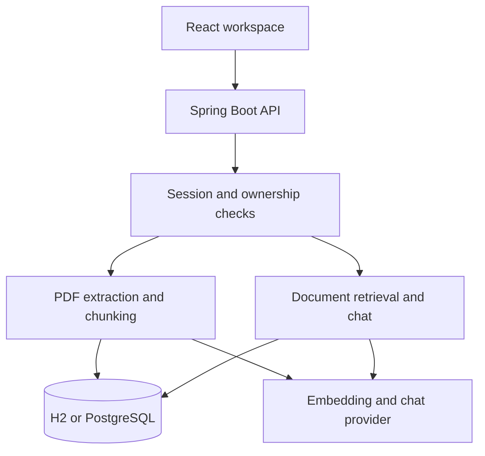

# Architecture

The browser calls a same-origin Spring Boot API. Vite proxies requests in development; the packaged application serves the compiled React assets directly.

## Indexing

1. Authenticate account, enforce limits and verify supported file format.
2. Extract PDF text one page at a time, keeping page numbers.
3. Normalize whitespace and split into chunks up to 1200 characters with 180-character overlap.
4. In AI mode generate embeddings before opening the persistence transaction.
5. Insert document metadata and all chunks atomically. In PostgreSQL AI mode, also insert vector rows.

Original uploaded binaries are not retained. Citation previews show extracted passages, not original PDF pages.

## Retrieval

All SQL retrieval queries enforce `documents.user_id` before results are returned.
Local retrieval scores token overlap. AI mode uses cosine similarity; PostgreSQL uses pgvector's cosine distance with an HNSW index, while H2 computes cosine in Java. Up to six passages are retrieved.
Optional document IDs further narrow the owner's scope. Foreign IDs cannot broaden access.
The prompt treats document text as untrusted source data and asks the model to decline when evidence is missing. This mitigates prompt injection but does not guarantee factual answers. Sources remain visible for verification.

## Conversations

A successful turn saves user and assistant messages together. Chat ownership is checked on read, append and delete. Six recent messages supply bounded chat context. Retrieval uses the current question, so follow-ups should name their topic clearly.
The model's cited indices determine which retrieved passage cards appear. Source excerpts are retained as historical snapshots. Claims are not automatically verified against the cited text.

## Security and storage

Passwords use bcrypt cost 12; passwords are restricted to bcrypt's 72-byte boundary.
Random 256-bit session tokens are returned once; only SHA-256 token hashes are stored. Sessions expire after 24 hours.
No cookie authentication is used; bearer headers are required for private API operations. No permissive CORS is enabled.
Upload size, PDF pages, document counts, chunk counts, request fields and request frequency are bounded.
Schema initialization uses idempotent SQL. Docker initializes the vector extension and vector table. This first version has no versioned migration runner; use deliberate migrations when evolving an existing database.
